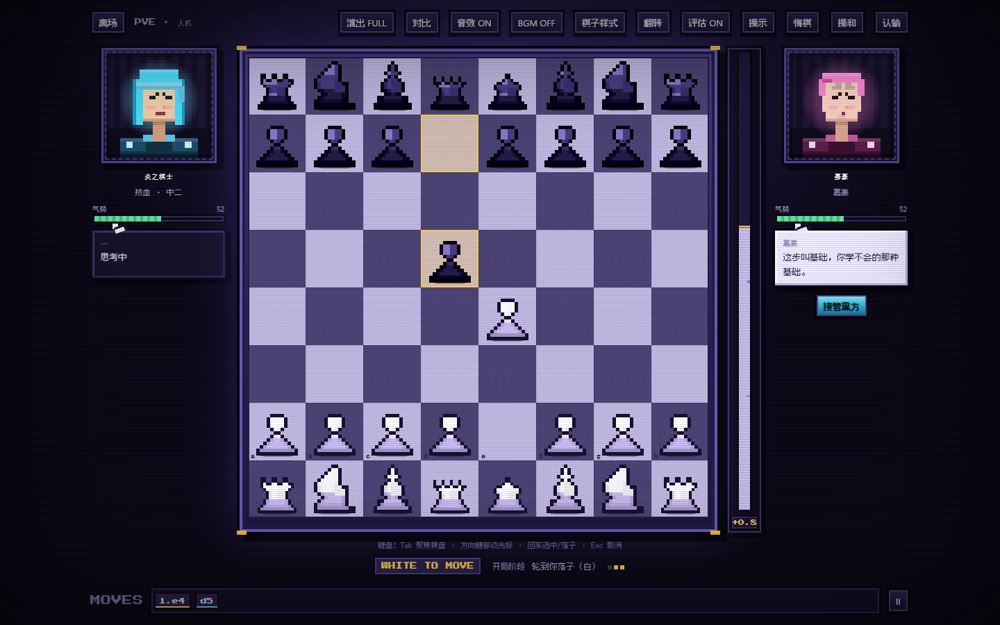
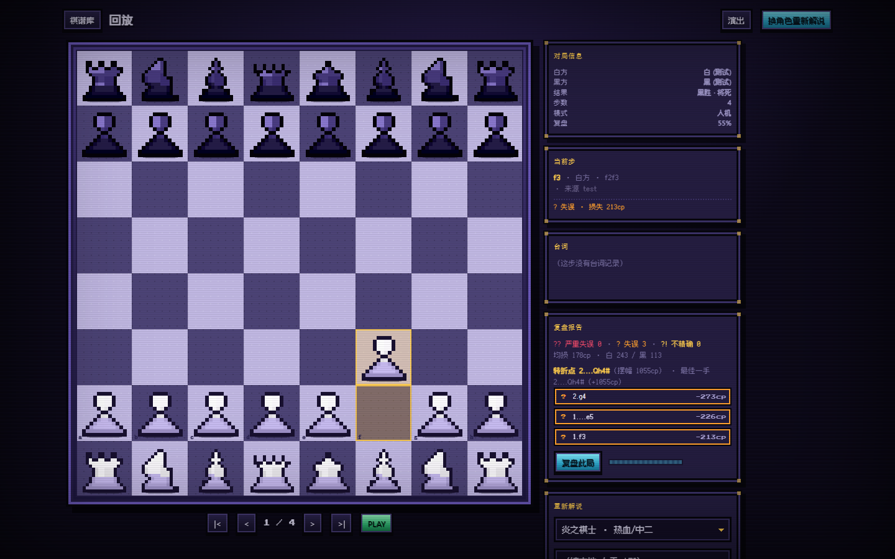
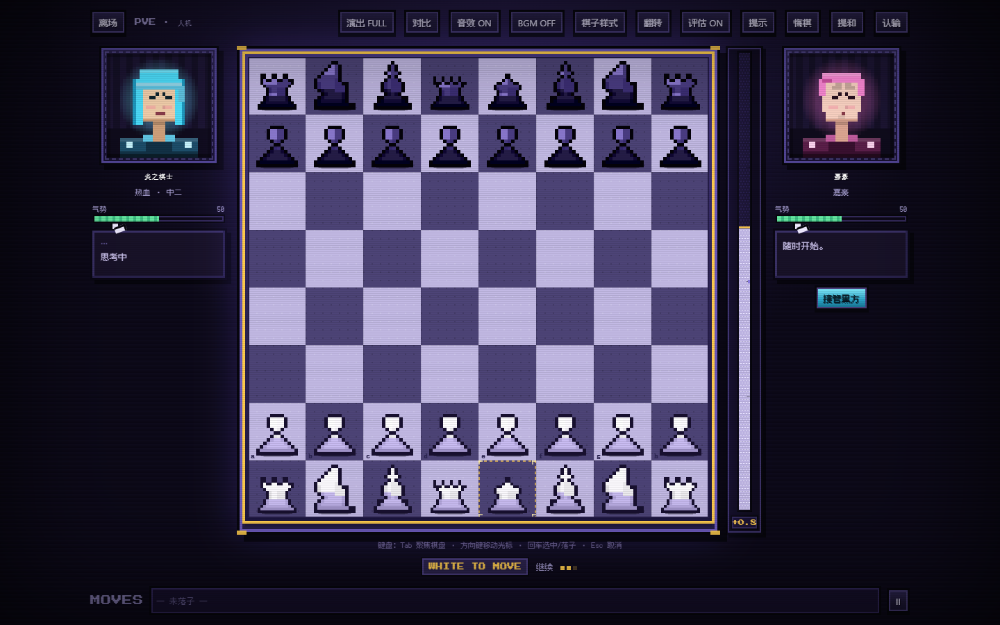
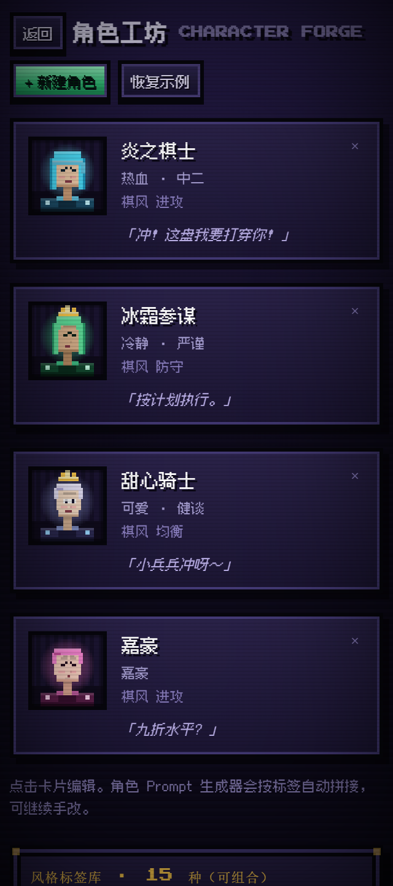
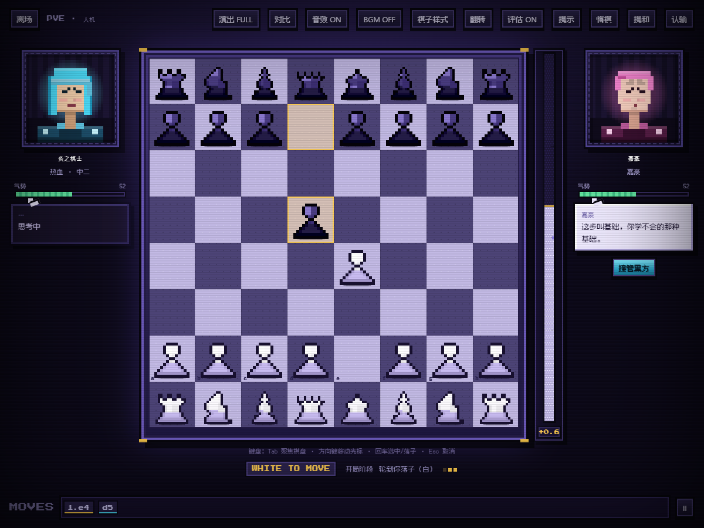
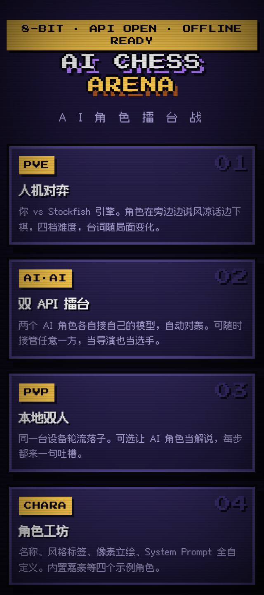

# AI CHESS ARENA · AI 角色擂台战

> 像素风国际象棋，AI 是角色，棋步是剧情。
>
> A pixel-art chess arena where AI characters play, taunt, and narrate.




---

## 这是什么

把国际象棋做成「角色对打」的舞台：棋盘是场地，AI 角色是有性格的选手。它既能在浏览器里跟本地 Stockfish 引擎下棋，也能让两个接了大模型 API 的角色互相对轰，还能同一台设备两人轮流、让 AI 在旁边解说吐槽。

整个项目是**纯前端、零运行时依赖**的静态站点——没有框架、没有打包器、没有 Node 服务端。两份产物：

| 产物 | 场景 | 启动方式 |
|---|---|---|
| `index.html` | 网站托管 / 本地服务器 | 双击 `run.bat`，或 `python -m http.server 8765` |
| `offline.html` | **完全离线**，双击即玩 | 双击打开即可（引擎与开局库已内联） |

> ⚠️ `index.html` 依赖 `fetch` 读取本地引擎源码，浏览器安全策略禁止 `file://` 这么做，所以它**必须走 HTTP**。想双击直接玩，请用 `offline.html`。

---

## 功能

### 三种对局模式

- **PVE 人机对弈** —— 你对战本地 Stockfish（asm.js，浏览器内 Worker 运行），四档难度，AI 角色随局面冒出台词。
- **AI·AI 双 API 擂台** —— 两个角色各自接自己的模型（`Base URL + Key + Model`），自动对轰；可随时接管任意一方。
- **PVP 本地双人** —— 同一台设备轮流落子，可选让 AI 角色当解说，每步一句吐槽。

### 角色与表现

- **角色工坊**：名称、风格标签、`System Prompt`、像素立绘全自定义；内置四个示例角色（炎之棋士 / 冰霜参谋 / 甜心骑士 / 嘉豪）。
- **程序化像素美术**：棋盘、棋子、角色立绘全部代码绘制，**无任何外部图片素材**。
- **像素评估条**：独立第二个 Stockfish Worker 实时出分，不影响走子搜索。
- **复盘报告**：终局后逐手评估，标注 `??` 严重失误 / `?` 失误 / `?!` 不精确，标出转折点与最佳一手，可存进棋谱并在回放页展示。
- **开局库**：ECO 编码 3606 个局面，走完即显示开局名，并可请求提示着法。
- **棋钟**：Fischer 增量，难度 × 余时联动思考预算。
- **悔棋 / 提和**：带人设化确认台词。
- **音效**：Web Audio 合成（ZzFX 风格），无音频文件；芯片音乐 BGM。

### 工程特性

- **完全键盘可玩**（WCAG 2.1.1）：Tab 进棋盘，方向键移动光标，回车落子，Esc 取消；屏幕阅读器逐步播报格子与局面。
- **响应式**：桌面 / 390px / 320px 三档已验收，棋盘像素整数倍缩放。
- **数据全本地**：角色、棋谱、配置存 `localStorage`；API Key 默认存 `sessionStorage`，勾选「记住密钥」才持久化。
- **代次隔离**：`Run` 中心管理每一次对局的取消与超时，旧局异步结果永不写回新局。

### 截图

| | |
|---|---|
| <br>**复盘报告**：逐手分级 + 转折点 | <br>**键盘走子**：光标导航 + ARIA 播报 |
| <br>**角色工坊**（320px 窄屏） | <br>**offline.html**：file:// 双击即玩 |
| <br>**首页**（320px） | |

---

## 快速开始

### 方式一：双击离线版（最简单）

直接双击 `offline.html`。不装任何东西，不需要服务器。

### 方式二：本地服务器（推荐开发时用）

需要 [Python 3](https://www.python.org/)（`run.bat` 会自动探测 `python` 或 `py`）：

```bash
# Windows：双击 run.bat
# 或者手动
python -m http.server 8765
# 浏览器打开 http://localhost:8765/index.html
```

### 使用 AI 角色（可选）

进入「API 配置」，填三项即可：

| 字段 | 说明 |
|---|---|
| `Base URL` | OpenAI 兼容端点，如 `https://api.deepseek.com/v1` |
| `API Key` | 你的密钥（仅存本地，默认会话级） |
| `Model` | 模型名，如 `deepseek-chat` |

支持 OpenAI 兼容 / Anthropic / 自定义请求体模板。**不配 API 也能玩**——PVE 模式用内置台词池，照样有角色味。

---

## 开发

### 目录结构

```
chess-arena/
├── run.bat                 双击启动本地服务器
├── index.html              HTTP 模式产物（引擎走 fetch）
├── offline.html            file:// 双击即玩产物（引擎/开局库内联）
├── css/main.css            全部样式（像素风，字体走 ../assets/fonts）
├── js/                     17 个构建产物分片（由 src/parts 同步，勿手改）
├── assets/
│   ├── fonts/              像素字体：ps2p.woff2 + fusion-pixel-subset.woff2（子集）
│   └── vendor/             chess.js、stockfish.js（上游原件）、stockfish.inline.js（生成）
├── data/                   开局库 openings.json + openings.inline.js（生成）
├── src/
│   ├── build.py            组装 + --check 校验 + --serve 开发服务器
│   ├── parts/              源码分片（唯一真源）
│   ├── subset_font.py      中文字体子集化
│   ├── fonts/              上游字体原件
│   └── pw/                 15 套 Puppeteer 测试 + run-tests.js
├── GDD.md                  设计决策与踩坑记录（推荐先读）
├── CONTEXT.md              会话上下文交接卡
├── THIRD_PARTY_NOTICES.md  第三方许可声明
├── docs/screenshots/       README 用的截图
├── README.md               本文件
└── LICENSE                 GPL-3.0
```

### 关键约定

> **永远改 `src/parts/`，不要改 `js/`。** `js/*.js` 是构建产物，`npm run build` 会覆盖。

### 常用命令

```bash
npm run build        # 从 src/parts 同步 js/ 与两份 HTML，并生成内联产物
npm run check        # 只校验不写文件（资源存在 / 语法 / 分片同步 / 字体覆盖）
npm start            # 校验 + 启动开发服务器（8765）
npm run serve        # 只启动服务器

npm run subset-font  # 改了界面文案后重新生成中文字体子集
npm test             # 15 套测试全跑（自动装依赖、自动起服务器、结束自动关）
```

单独跑某个套件（需先手动起 `http.server 8765`）：

```bash
node src/pw/test_review.js
```

### 环境要求

- **Node.js ≥ 18**（仅测试与构建需要；运行时零依赖）
- **Python ≥ 3.8**（构建与字体子集化；`build.py` 纯标准库，`subset_font.py` 需 `pip install fonttools brotli`）
- 测试用 Chrome / Chromium（`puppeteer-core` 会自动装；可用 `CHROME_PATH` 指定）

### 架构要点

- 经典 `<script>` 顺序加载，**全局对象图**：`Run`（代次中心）· `Engine`（主搜索 Worker）· `Analysis`（第二评估 Worker）· `Game`（对局控制器）· `UI` / `BoardView` / `ApiContract`。
- 每个 `await` 之后必须 `Run.isLive(token)`，防止旧局写回新局。
- 构建期契约校验（`npm run check`）防止产物与源码分片漂移。

更详细的设计决策、已修复缺陷、踩坑清单见 [`GDD.md`](GDD.md)。

---

## 第三方与许可

本项目以 **GNU General Public License v3.0** 发布，全文见 [`LICENSE`](LICENSE)。

内联/引用的第三方组件及各自许可证（完整声明见 [`THIRD_PARTY_NOTICES.md`](THIRD_PARTY_NOTICES.md)）：

| 组件 | 用途 | 许可证 |
|---|---|---|
| [chess.js 0.10.3](https://github.com/jhlywa/chess.js) | 合法着法 / FEN / PGN | BSD-2-Clause |
| [Stockfish 10](https://github.com/niklasf/stockfish.js) | 本地引擎（asm.js） | **GNU GPL v3** |
| [Press Start 2P](https://fonts.google.com/specimen/Press+Start+2P) | 英文像素字体 | SIL OFL 1.1 |
| [Fusion Pixel Font](https://github.com/TakWolf/fusion-pixel-font) | 中文像素字体 | SIL OFL 1.1 |
| [ZzFX](https://github.com/KilledByAPixel/ZzFX) | 音效合成思路 | MIT |

> 因内联了 GPL v3 的 Stockfish，本项目整体选择 GPL-3.0 发布，与之一致。

---

## 已知边界

- `index.html` 必须经 HTTP 访问（`file://` 下浏览器禁止 `fetch` 本地资源）；要双击即玩请用 `offline.html`。
- 引擎为老 asm.js 构建，非 WASM；单线程 Worker。
- 不提供后端代理，API Key 与请求均从浏览器直发；请自行评估使用环境的合规与密钥暴露风险。
- 数据仅存本机浏览器存储，换设备 / 清缓存即丢失（无云端同步）。

---

*Made with zero dependencies, some pixel fonts, and a lot of console.log.*
